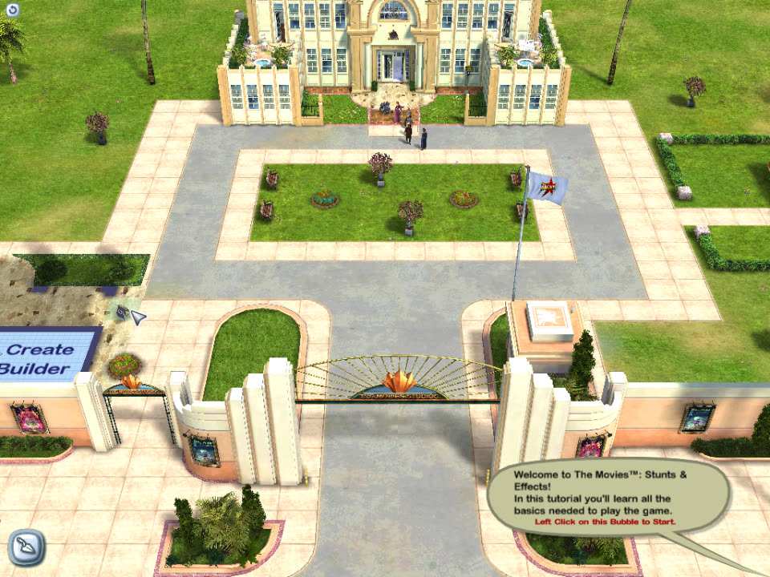

# The Movies in the browser

Play Lionhead's **The Movies: Stunts & Effects** in a web browser, using your own copy of the game.

**Play:** [themovies.romanf.cc](https://themovies.romanf.cc)



This is not a remake. The game's original `MoviesSE.exe` is statically translated
from x86 to WebAssembly, and the Windows APIs it calls (Direct3D 9, DirectInput,
DirectSound, DirectShow, files, threads, registry) are reimplemented for the
browser. Graphics run on WebGPU, sound on Web Audio, and the game's movies are
decoded with ffmpeg.wasm. The original executable is never modified.

> Fan project, not affiliated with or endorsed by Lionhead Studios, Activision or
> Microsoft. The Movies is a trademark of its owners. **No game files are included
> or hosted.** You need your own copy of the game.

## Status

The main menu, the studio lot, building, hiring, sound and in-game movies work.
The lot runs at about 40 fps in headless Chrome on an Apple Silicon Mac. This is
an experimental port: expect bugs. The play page can send an error report when the
game stops, and you can turn that off.

Detailed progress, measurements and known limits are in
[docs/research/static-startup-status.md](docs/research/static-startup-status.md).

## Requirements

- Desktop **Chrome or Edge** with WebGPU. Safari and Firefox are not supported yet.
- The English **The Movies: Stunts & Effects 1.2**: the `Game Files` folder with
  `MoviesSE.exe` (June 2006) and `Data`. The page checks the executable's SHA-256
  before starting.

When you play, the page reads the game folder directly from your computer. Nothing
is uploaded. Settings and saves are stored in the browser (OPFS).

## How it works

| Part | Where |
| --- | --- |
| Static x86 → C → WebAssembly translation, based on [retro-port](https://github.com/Dhaiwat10/retro-port) | `scripts/translate-game.py`, `scripts/recover-functions.py`, `patches/` |
| Windows API layer (D3D9, DirectInput, DirectSound, DirectShow, files, threads…) | `native/` |
| Direct3D 9 to WebGPU renderer, audio worklet, media decoder, local game files | `public/` |
| Play page | `public/play.html` |
| Hosting: a Worker serving the site from R2, and the error-report collector (D1) | `workers/` |
| Research notes and API call maps | `docs/research/` |

Game code is generated only into the gitignored `.cache/` directory. The published
reports in `docs/research/` contain metadata only.

## Development

You need Node 20+ and Python 3.10+. There are no npm dependencies.

Put your game folder (or a symlink to it) at `.cache/game-files`. The scripts use it by
default, and every script also accepts an explicit path.

```bash
ln -s "/path/to/The Movies/Game Files" .cache/game-files
```

Building the game from source is a pipeline that downloads pinned tools into `.cache/`:

1. `scripts/setup-analysis-tools.py`: portable Ghidra and JDK.
2. `scripts/recover-functions.py`: function boundaries.
3. `scripts/translate-game.py`: translation to C with retro-port. See
   [recompilation-probe.md](docs/research/recompilation-probe.md) for the toolkit and Emscripten setup.
4. `scripts/build-bootstrap.py --target wasm` and `scripts/stage-static-browser.py`: compile and stage the browser build.

Each script verifies the hashes of its inputs and tools.

Then build the public site and run it locally:

```bash
npm run build:site     # writes dist/ (never contains game files)
npm run preview:site   # http://127.0.0.1:4175
```

`public/static-probe.html` (served by `npm start`) is the diagnostic page, with
tracing, timing and build options.

### Tests

```bash
npm test               # JavaScript and Python tests
npm run test:native    # API-layer contract tests (needs the cached retro-port headers)
node scripts/bench/play-page-check.mjs   # headless end-to-end run of dist/ with your game folder
```

### Deploying

`npm run deploy:site` builds the site, uploads it to R2 and deploys `workers/site`
(after `npx wrangler login`). Setting up the error-report collector is described in
[`workers/crash-reports/wrangler.toml`](workers/crash-reports/wrangler.toml).
`scripts/reports.mjs` reads reports.

## Boxedwine reference build

An earlier approach ran the unmodified game through [Boxedwine](https://github.com/danoon2/Boxedwine)
and Wine's Direct3D-to-WebGL bridge. It reached the main menu but was too slow to
play. It remains available for comparison (`npm start`, then open
http://127.0.0.1:4173). Setup, pinned versions and patches are described in
[docs/PORTING.md](docs/PORTING.md) and [patches/README.md](patches/README.md). Why the
project moved to static translation is explained in
[docs/research/native-port-decision.md](docs/research/native-port-decision.md).

## Credits

- [retro-port](https://github.com/Dhaiwat10/retro-port) for the x86 translator and runtime.
- [ffmpeg.wasm](https://github.com/ffmpegwasm/ffmpeg.wasm) (FFmpeg, GPL-2.0-or-later) for movie decoding.
- [Boxedwine](https://github.com/danoon2/Boxedwine) (GPL) and [Wine](https://www.winehq.org/) for the reference build.
- [Ghidra](https://github.com/NationalSecurityAgency/ghidra) for function recovery.

Made by [lazyd3v](https://lazyd3v.com). If you enjoy it, you can
[buy me a coffee](https://buymeacoffee.com/romanf).
